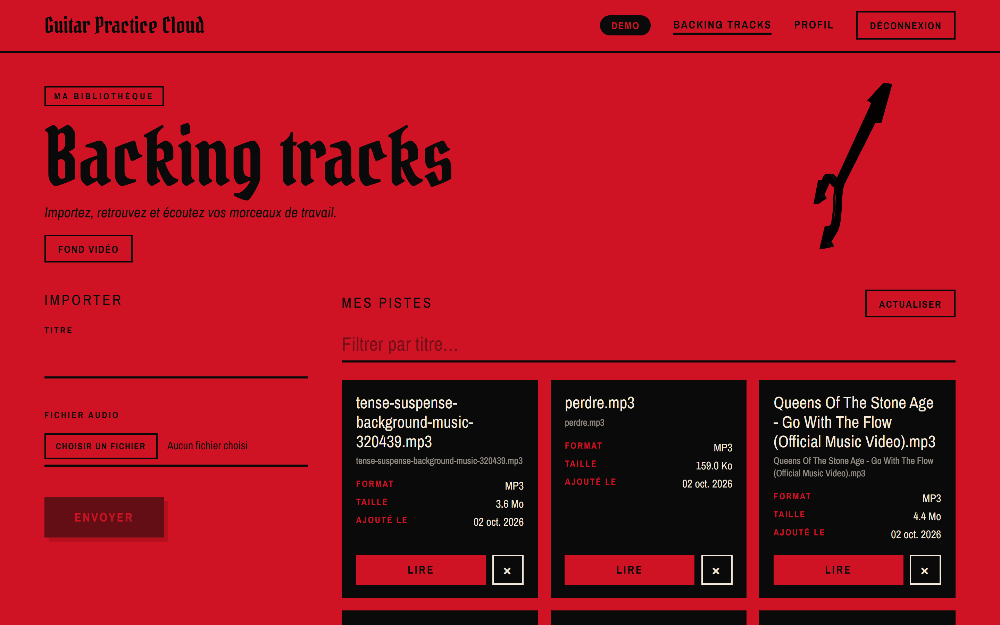
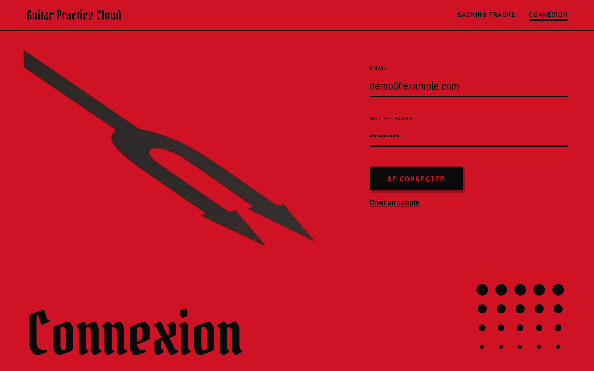
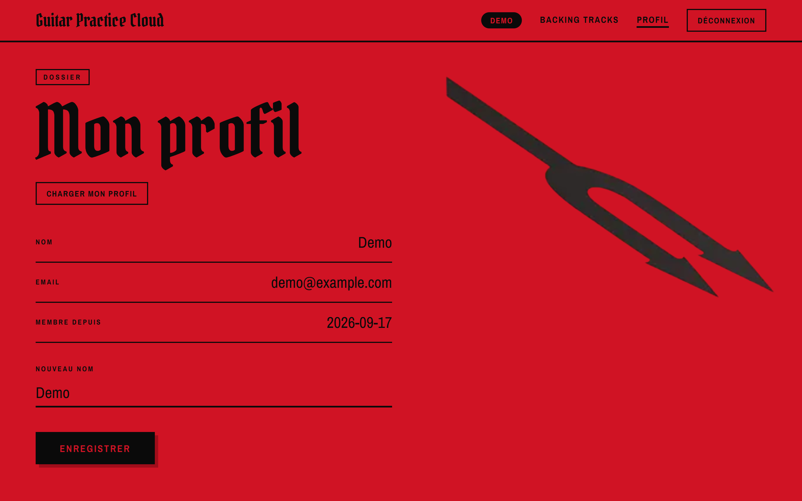
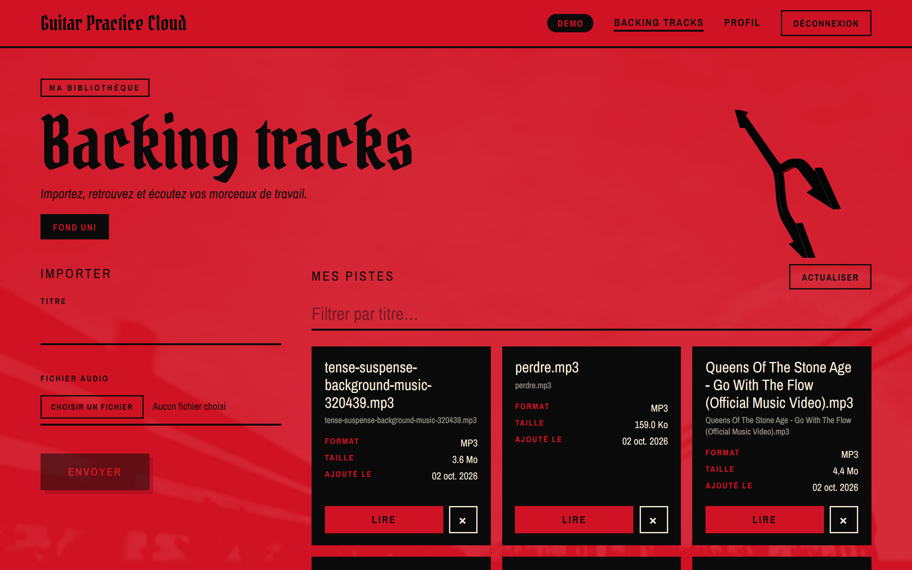
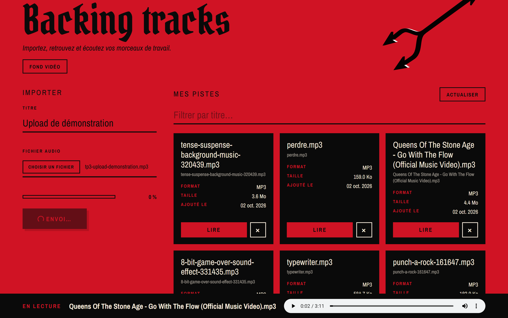
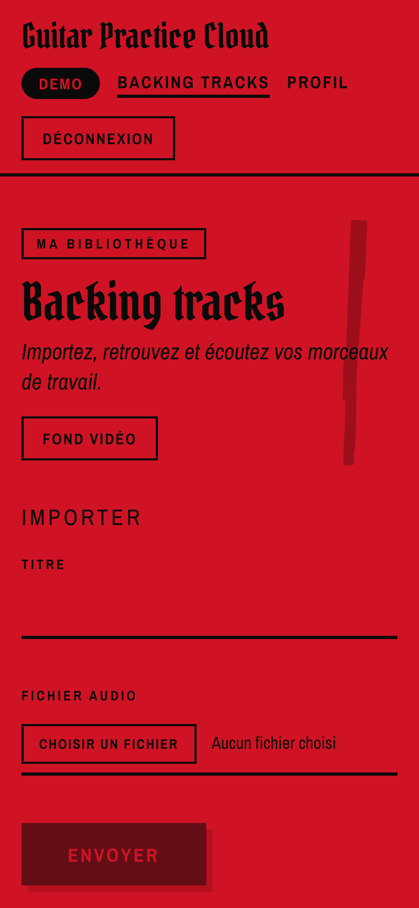
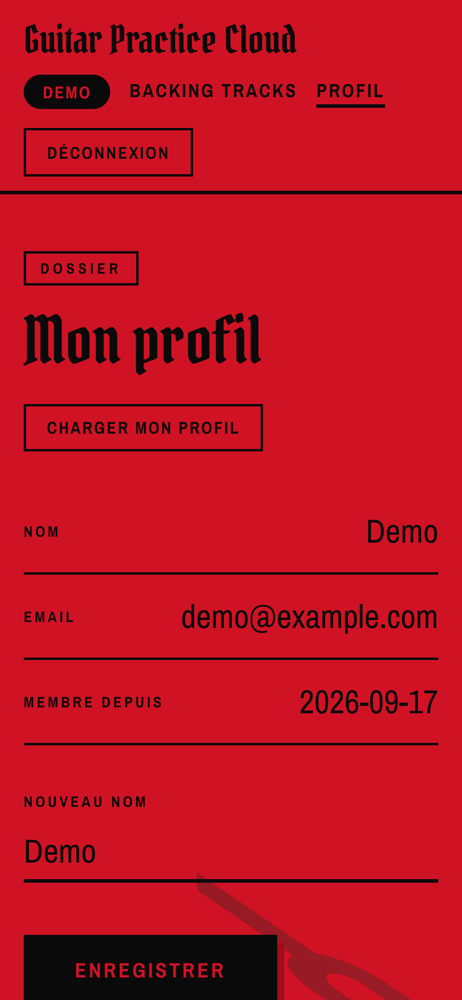

# Guitar Practice Cloud — "Desert Sessions" edition

A web app to store and play your guitar **backing tracks**: create an account, upload audio files,
browse your library page by page and play them in the browser. Angular 22 frontend, Node.js +
Express 5 + MongoDB backend.

- **Author:** Mathys Bellini--Le Gall — M1 MIAGE, Université Côte d'Azur, 2026-2027
  (Web technologies, practical sessions TP1 to TP3).
- **Repository:** <https://github.com/xDraawwScript/AngularM1_Miage_2026_2027_TP123>
- **Starting point:** the student package provided by Michel Buffa (backend, Angular starter and
  assignments), described in the [original README](#original-package-readme) below.



## Contents

- [What was built on top of the starter](#what-was-built-on-top-of-the-starter)
- [Screenshots](#screenshots)
- [Quick start](#quick-start)
- [Architecture](#architecture)
- [Backend API](#backend-api)
- [Tests](#tests)
- [Documentation map](#documentation-map)
- [AI assistance](#ai-assistance)
- [Original package README](#original-package-readme)

## What was built on top of the starter

The package came with a working backend and an Angular starter to complete: basic pages, services
and routes, without styling, feedback states or tests. Everything below was added during the three practical sessions (the backend routes were
not modified).

| Area | What was added |
|---|---|
| **Accounts** (TP1) | Sign-up, sign-in and profile pages wired to the API: form validation, error messages (401, 409…), JWT stored and sent by an HTTP interceptor, protected routes with a guard, username shown in the navigation bar, username change |
| **Library** (TP2) | Server-side pagination with Angular Material's paginator (French labels, 6 tracks per page), track cards (format, readable size, date added), title filter, play / pause through a Blob and an object URL that is always released |
| **Upload** (TP2-TP3) | Format and size checks before sending (MP3, WAV, OGG, M4A, 25 MB), explicit states (idle, uploading with a percentage, success, error), controls locked during the upload. `withXhr()` was needed because Angular 22's default `fetch` backend cannot report upload progress |
| **Delete** (TP3) | Confirmation, "deleting" state against double clicks, snackbar feedback, 404 / 500 handling, playback stopped and previous page reloaded when the last track of a page is removed |
| **Design** | "Desert Sessions" visual identity (flat red, black, gothic lettering) designed in Figma, then implemented on the four pages as a small CSS design system; responsive down to phones |
| **Extras** | Optional muted YouTube video background on the library (privacy-friendly `youtube-nocookie` embed), interactive 3D trident drawn with three.js |
| **Tests** (TP3) | 41 frontend tests (Vitest + jsdom, no server needed) and 12 backend contract / security tests (401 cases, forged and expired JWT, upload validation, pagination bounds) |

### Screenshots

| Sign in | Profile |
|---|---|
|  |  |
| **Library with the video background** | **Upload in progress** |
|  |  |

<p align="center">
  
  
</p>

All 18 captures (every page and state, desktop and mobile) are listed in
[`preuves/README.md`](preuves/README.md).

## Quick start

Requirements: Node.js 22 or newer and a MongoDB Atlas database (see [`ATLAS_SETUP.md`](ATLAS_SETUP.md)).

**1. Backend** (`http://localhost:3000`):

```bash
cd backend
cp .env.example .env    # fill MONGODB_URI and JWT_SECRET; never commit this file
npm install
npm start
```

**2. Frontend** (`http://localhost:4200`), in another terminal:

```bash
cd frontend-starter
npm install
npm start               # ng serve, /api is proxied to the backend (proxy.conf.json)
```

Demo account: `demo@example.com` / `Demo1234!`.

**3. Tests:**

```bash
cd frontend-starter && npm test   # 41 tests, no backend needed
cd backend && npm test            # 14 tests (2 original + 12 added), no database needed
```

## Architecture

```text
Angular 22 (frontend-starter/, port 4200)              Express 5 (backend/, port 3000)        MongoDB Atlas
  pages ── signals ── services ── HttpClient ──/api──►  routes in src/app.js ── Mongoose ──►   users, tracks
              authGuard        authInterceptor          JWT middleware                       (metadata only)
              (protected        (adds Bearer token)     Multer ──► data/uploads/ (audio files on disk)
               routes)
```

| Folder | Content |
|---|---|
| [`frontend-starter/src/app/components/`](frontend-starter/src/app/components/) | Pages (login, register, profile, tracks) and building blocks: track card, upload form, video background, 2D and 3D tridents |
| [`frontend-starter/src/app/shared/`](frontend-starter/src/app/shared/) | Services (`AuthService`, `TrackService`), guard, interceptor, models, audio file helpers, and their tests (`*.spec.ts`) |
| [`backend/src/`](backend/src/) | Express app (`app.js`: routes, JWT, Multer), server start-up, Mongoose models `User` and `Track` |
| [`backend/test/`](backend/test/) | API and security tests (`node:test`) |
| [`preuves/`](preuves/) | Screenshots used as proof for each session |

Request flows explained step by step (sign-in, upload, audio playback, delete), in French:
[`schema-reponse-td1.html`](schema-reponse-td1.html), [`schema-reponse-td2.html`](schema-reponse-td2.html),
[`schema-reponse-td3.html`](schema-reponse-td3.html) (download and open them in a browser).

## Backend API

Base URL `/api`. Every route except health, sign-up and sign-in expects
`Authorization: Bearer <token>` (JWT valid for 2 hours). Errors are JSON: `{ "message": "…" }`.

| Method | Route | Body / query | Main response |
|---|---|---|---|
| GET | `/health` | — | `{ "status": "ok" }` |
| POST | `/auth/register` | `{ name, email, password }` | `201 { token, user }` (`409` if the email is taken) |
| POST | `/auth/login` | `{ email, password }` | `200 { token, user }` (`401` on wrong credentials) |
| GET | `/users/me` | JWT | `200 User` |
| PUT | `/users/me` | `{ name }` + JWT | `200 User` |
| GET | `/tracks?page=1&limit=6` | JWT | `Page<Track>`: `items`, `page`, `limit`, `total`, `pages` (limit 1-20) |
| POST | `/tracks` | multipart: `audio`, `title` | `201 Track` (MP3, WAV, OGG, M4A, 25 MB maximum) |
| GET | `/tracks/:id/audio` | JWT | audio stream |
| DELETE | `/tracks/:id` | JWT | `204`; `404` if the track does not exist or belongs to someone else |

MongoDB stores users and track metadata; the audio bytes stay on the server's disk. Full contract:
[`API_CONTRACT.md`](API_CONTRACT.md) (in French).

## Tests

| Suite | Command | Count | What it covers |
|---|---|---|---|
| Frontend | `cd frontend-starter && npm test` | 41 | Auth and track services (requests checked with `HttpTestingController`), guard, interceptor, audio file checks, library page (pagination, playback, delete cases), upload states |
| Backend | `cd backend && npm test` | 14 | Health without MongoDB, Mongoose schemas, 401 on every protected route, forged / expired JWT, upload without a file or with a wrong type, pagination bounds |

Expected vs observed results for each test: [`RAPPORT_TESTS_TP3.md`](RAPPORT_TESTS_TP3.md) (in French).

## Documentation map

| Document | What you will find | Language |
|---|---|---|
| [`SUJET_ETUDIANT_TP1.md`](SUJET_ETUDIANT_TP1.md), [`TP2`](SUJET_ETUDIANT_TP2.md), [`TP3`](SUJET_ETUDIANT_TP3.md) | The assignments of the three sessions | French |
| [`API_CONTRACT.md`](API_CONTRACT.md) | HTTP contract of the backend | French |
| [`RAPPORT_IA_MODELE.md`](RAPPORT_IA_MODELE.md) | Mission-by-mission report: goal, prompt, plan, checks, rejected proposals, files changed, proof, design decisions | French |
| [`RAPPORT_TESTS_TP3.md`](RAPPORT_TESTS_TP3.md) | Test report (expected / observed) | French |
| `schema-reponse-td1/2/3.html` | Architecture and request-flow diagrams, answers to the session questions | French |
| [`preuves/README.md`](preuves/README.md) | Index of all screenshots | French |
| [`ATLAS_SETUP.md`](ATLAS_SETUP.md) | Creating the MongoDB Atlas database | French |
| [`CONSEILS_POUR_UTIISER_ASSISTANT_AI.md`](CONSEILS_POUR_UTIISER_ASSISTANT_AI.md), [`backend/CLAUDE.md`](backend/CLAUDE.md) | Guidelines for using an AI assistant on this project (from the original package) | French |

## AI assistance

This project was developed with an AI coding assistant (Claude Code). Each mission was planned and
discussed before coding, then checked in a real browser and with tests. The prompts, plans,
rejected proposals and what was verified are recorded in
[`RAPPORT_IA_MODELE.md`](RAPPORT_IA_MODELE.md) (in French).

---

## Original package README

*The section below is the original README of the student package (in French), kept as is; only
the heading levels changed.*


Ce dépôt contient uniquement les ressources nécessaires aux trois TP :
`backend/` et `frontend-starter/`, ainsi que les sujets et documents utiles.

### Prérequis

- Node.js 22 ou plus récent ;
- un compte MongoDB Atlas par binôme ;
- Git et un navigateur récent.
- Un IDE de qualité
- Recommandé : un abonnement à un 

Consulter [ATLAS_SETUP.md](ATLAS_SETUP.md) pour créer la base de données.

### Démarrer le backend

```bash
cd backend
cp .env.example .env
```

Renseigner dans `.env` l’URI MongoDB Atlas et le secret JWT. Ne jamais publier
ce fichier ni copier un secret dans le code Angular.

```bash
npm install
npm start
```

Le backend écoute normalement sur `http://localhost:3000`.

### Démarrer le frontend

Dans un autre terminal :

```bash
cd frontend-starter
npm install
npm start
```

Ouvrir `http://localhost:4200`. Le compte de démonstration est
`demo@example.com` / `Demo1234!`.

### Documents de travail

- [SUJET_ETUDIANT_TP1.md](SUJET_ETUDIANT_TP1.md), [SUJET_ETUDIANT_TP2.md](SUJET_ETUDIANT_TP2.md) et [SUJET_ETUDIANT_TP3.md](SUJET_ETUDIANT_TP3.md) : missions des trois séances ;
- [API_CONTRACT.md](API_CONTRACT.md) : endpoints, authentification et formats échangés ;
- [RAPPORT_IA_MODELE.md](RAPPORT_IA_MODELE.md) : modèle de compte rendu.
- [CONSEILS_POUR_UTIISER_ASSISTANT_AI.md](CONSEILS_POUR_UTIISER_ASSISTANT_AI.md) : utiliser correctement un assistant IA, quel que soit l’outil choisi.

Le backend contient également ses propres consignes pour les assistants :
[`backend/AGENTS.md`](backend/AGENTS.md), [`backend/CLAUDE.md`](backend/CLAUDE.md),
[`backend/GEMINI.md`](backend/GEMINI.md) et
[`backend/best-practices.md`](backend/best-practices.md). Elles couvrent
Node.js, Express, Mongoose, MongoDB, l’authentification, Multer, les uploads,
les logs et les tests.

Les fichiers audio présents dans `frontend-starter/fichiers-audio-de-test/` sont
des fixtures fournies pour les essais. Aucun fichier uploadé, dossier de
dépendances (`node_modules`), fichier `.env` ou identifiant local n’est inclus.
